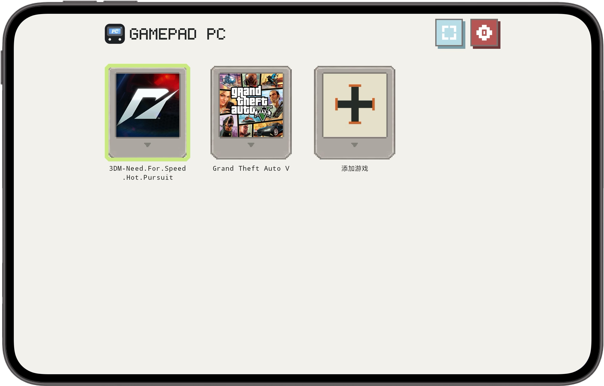

# GamePad PC

> **在 Android 平板上整理并启动本地 PC 游戏。**  
> Organize and launch local PC games on an Android tablet.

GamePad PC 游戏库截图 · GamePad PC library screenshot

<a href="https://gamefold.pages.dev">产品官网 / Official site</a> · <a href="https://github.com/lavande16/gamepad-pc-private/releases/tag/gamepad-pc-2.4-10033">下载 V2.4 / Download</a>

## 当前基线 · Current baseline

| 项目 | 信息 |
|---|---|
| 版本 | **GamePad PC V2.4 · versionCode 10033** |
| Android 包名 | **com.gamepad.pc** |
| APK | [GamePad-PC-V2.4-2304X1296-10033.apk](https://github.com/lavande16/gamepad-pc-private/releases/tag/gamepad-pc-2.4-10033) |
| SHA-256 | `f3b8cbb53d712537e00083ca8b7164592b0b2204f63bfb7e1a6dc8af9cb17b31` |
| 显示配置 | 2304 × 1296 基线配置 |

## 为平板触控而设计 · Designed for tablet touch

- **一眼看清游戏区域与触控区：**V2.4 以 2304 × 1296 显示配置为基线，并为横向握持下方的触控操作留出空间。显示表现会因设备、系统和外接屏而异。  
  **Keep the game and controls in view:** V2.4 uses a 2304 × 1296 display profile and leaves room for touch controls along the lower area in landscape play. Results vary by device, system and external display.
- **围绕游戏操作组织触控布局：**将屏幕上的虚拟手柄作为主要操作入口，适合在没有实体手柄时触控游玩。  
  **Controls within reach:** use the on-screen virtual gamepad as the primary input when a physical controller is not available.
- **从空库开始也容易理解：**首次整理自己的游戏入口时，界面保持简洁；具体导入与游戏启动方式取决于对应设备和内容。  
  **A clear starting point:** the library stays approachable while you add your own game entries. Import and launch behavior depends on your device and content.
- **保留社区与设置入口：**项目包含 3DM 相关入口和显示设置；网络内容与第三方服务由其提供方负责。  
  **Community and display settings:** the app retains a 3DM-related entry and display controls. Online content and third-party services are provided by their respective owners.

> 本仓库保留 GamePad PC V2.4 的源码和继续开发所需的运行时归档。Release APK 放在 GitHub Release，不放进 Git 历史；运行时归档位于 `app/src/legacy/assets/`。仓库不包含商业游戏文件。  
> This repository preserves the GamePad PC V2.4 source and the runtime archive required for continued development. The APK is distributed through GitHub Releases, not Git history; the runtime archive is under `app/src/legacy/assets/`. Commercial game files are not included.

## 下载与继续开发 · Download and continue development

从 [V2.4 Release](https://github.com/lavande16/gamepad-pc-private/releases/tag/gamepad-pc-2.4-10033) 获取基线 APK；从仓库的源码、`app/src/legacy/assets/` 和项目构建配置继续开发。签名材料和本机生成文件不属于此备份。  
Download the baseline APK from the [V2.4 Release](https://github.com/lavande16/gamepad-pc-private/releases/tag/gamepad-pc-2.4-10033). Continue from the source, `app/src/legacy/assets/` and project build configuration. Signing material and machine-generated files are not part of this backup.

实际兼容性因设备与游戏而异。请只使用自己有权访问的游戏内容；GamePad PC 与第三方游戏、网站或品牌没有官方隶属关系。  
